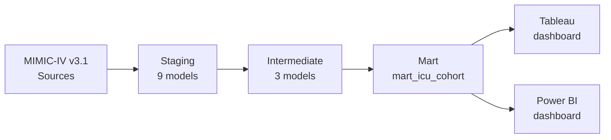
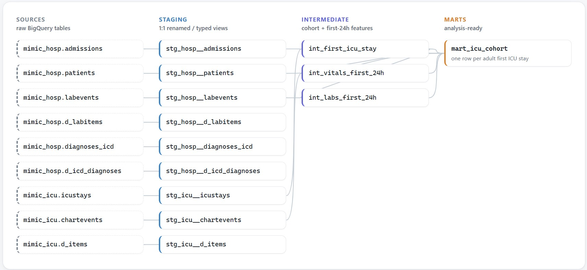
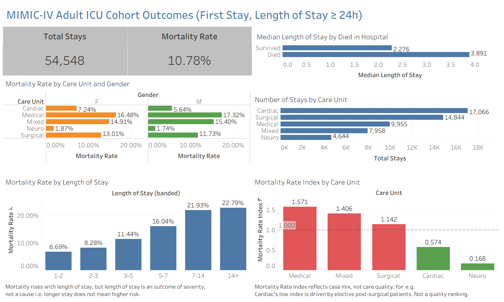
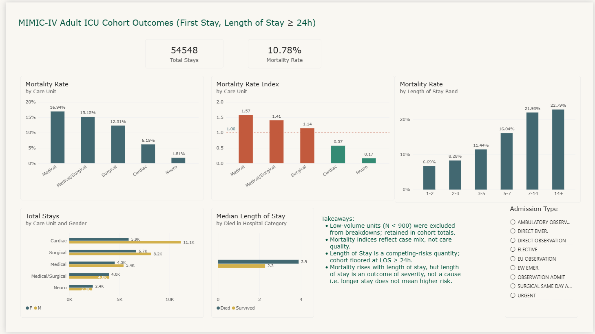

# MIMIC-IV ICU Analytics Pipeline

A tested, documented **dbt + BigQuery** analytics-engineering pipeline that transforms ~120M rows of raw MIMIC-IV v3.1 critical care data into an analysis-ready adult ICU cohort mart, designed to support downstream in-hospital mortality prediction and survival analysis, with parallel **Tableau** and **Power BI** cohort outcome dashboards built on top of the mart.

---

## Overview

This project builds the SQL/dbt layer that stands between raw electronic health record data and downstream analytics. It follows the standard analytics-engineering pattern, staging → intermediate → marts, with disciplined testing, documentation, cost management, and design-decision documentation appropriate for a production dbt project on BigQuery. The mart is then surfaced through two BI dashboards, one in Tableau and one in Power BI, built to the same specification (see [BI dashboards](#bi-dashboards)).

**Clinical framing.** Given features observed in the first 24 hours of a patient's first ICU stay, predict the probability of in-hospital mortality. This is a *prognostic* framing that matches how established ICU severity scores (APACHE II/III, SAPS II/III, SOFA, OASIS) are constructed and how such a model would be deployed clinically - scored once at hour 24 to inform risk stratification and resource allocation.

**Portfolio scope.** This repository covers the SQL/dbt cohort-construction layer plus a descriptive BI layer over the resulting mart. Remaining analytical modules, including predictive and survival modeling, MLOps deployment, and an agentic text-to-SQL interface, are designed against this mart and scoped under [Future Work](#future-work).

---

## About the data

**MIMIC-IV v3.1** is a de-identified critical-care electronic health record dataset released by the MIT Laboratory for Computational Physiology. It covers patients admitted to intensive care units and the emergency department at Beth Israel Deaconess Medical Center (Boston, MA) between 2008 and 2019. The dataset contains approximately **364,000 patients, 546,000 hospitalizations, and 94,000 ICU stays**, with structured data spanning demographics, vital signs, laboratory results, medications, procedures, and clinical notes. MIMIC-IV is one of the most widely-used datasets for clinical prediction research, benchmarking of ICU severity scores, and methodological work in healthcare machine learning.

<!-- MIMIC-IV is one of the most widely-used datasets for clinical prediction research, benchmarking of ICU severity scores, and methodological work in healthcare machine learning. Its scale, longitudinal coverage, and structured relational schema make it well suited for constructing analysis ready cohorts that support downstream statistical modeling. -->

**Access and governance.** MIMIC-IV is credentialed data, not open data. Use requires (1) a PhysioNet account with completed CITI "Data or Specimens Only Research" training, and (2) signed acceptance of the PhysioNet Credentialed Health Data Use Agreement. Once approved, the dataset is available as flat files or as read-only BigQuery tables ( as used in this project) in the `physionet-data` GCP project. All work occurs inside the credentialed environment and no patient-level data leaves it.

**De-identification and its analytical consequences.** Patient identifiers are replaced with random ciphers, and each patient's timestamps are shifted by a random per-subject offset measured in days. Intra-patient time intervals are preserved exactly (a 4-hour gap between two measurements remains a 4-hour gap), but across the population `charttime` values are scattered over ~100+ years of shifted calendar time. This property directly motivates the monthly-partitioning decision documented under [Design Decisions](#design-decisions).

---

## Architecture



**Staging (`models/staging/`):** 1:1 light cleaning over source tables: column selection, snake_case renaming, type casting, and early filtering to canonical itemid panels on the two high volume event tables. No business logic.

**Intermediate (`models/intermediate/`):** reusable building blocks consisting of a cohort spine, first 24h vital aggregates and first 24h lab aggregates. Coalescing, unit conversion (e.g. Fahrenheit → Celsius), and bounding physiological marker values to plausible ranges sourced from MIT-LCP `mimic-code` (see [Plausibility bounds](#plausibility-bounds-mit-lcp-verbatim-deviations-flagged-explicitly)).

**Mart (`models/marts/`):** a wide-format analysis-ready cohort mart, one row per stay, joining demographics, admission attributes, outcomes, and first-24h (lab and vital) feature summaries.

**BI (`docs/exploration/dashboard/`):** two cohort-outcomes dashboards, one in Tableau and one in Power BI, both reading `mart_icu_cohort` directly from BigQuery. See [BI dashboards](#bi-dashboards).



---

## Cohort definition

- **Population:** adults (`age_at_intime ≥ 18`) at their first ICU stay 
- **Grain:** one row per `subject_id`, keyed on their earliest `stay_id` chronologically
- **Eligibility filter:** ICU length of stay ≥ 24 hours

The LOS ≥ 24h filter is a **feature-engineering constraint, not a clinical exclusion.** Patients discharged or deceased before hour 24 do not have an observable 24-hour feature window under the current design and so cannot be scored. This is documented deliberately as a known cohort limitation: the analyzed population represents a "sick enough to stay 24h, not so sick they died in 24h" band.

### Age computation

Age at ICU admission is computed from MIMIC-IV's explicit formula rather than using `anchor_age` directly:

```sql
date_diff(date(intime), date(anchor_year, 1, 1), year) + anchor_age
```

MIMIC-IV shifts each patient's timestamps independently for de-identification while `anchor_age` remains fixed at the anchor year. Correct age-at-intime requires composing the two. Ages above 89 are HIPAA top-coded to 91.

---

## Outcome design

The mart carries **multiple outcome columns** rather than a single label:

| Column | Definition | Source |
|---|---|---|
| `died_in_hospital` | Death before discharge from this admission | `admissions.hospital_expire_flag` |
| `died_within_30d` | Death within 30 days of ICU `intime` | Derived from `patients.dod` |
| `died_within_1y` | Death within 1 year of ICU `intime` | Derived from `patients.dod` |

**Rationale.** `hospital_expire_flag` conflates biological mortality with location-of-death:

- Patients discharged alive who die shortly after (labeled 0) are structurally different from patients who truly survive long-term (also labeled 0).
- Hospice discharges, a clinical decision that death is imminent, count as false positives under standard evaluation.
- Features that predict `died_in_hospital` mix biological severity with likelihood of *being in a hospital at time of death*. This is a healthcare-system artifact that may not generalize across institutions.

Reporting the same metrics on `died_within_30d` and `died_within_1y` makes the *gap* itself interpretable; a small gap suggests the model captures generalizable near-term mortality risk a large gap suggests it partly captures location-of-death signal.

Right-censoring encoding (`event_time`, `event_observed`) for Cox / Kaplan-Meier survival analysis is scoped under [Future Work](#future-work). Note that a null `dod` (date of death) means "unobserved," not "survived," and treating it otherwise would conflate true survival with unlinked out-of-hospital death. 

---

## Data model

### Staging (9 models)

| Model | Description |
|---|---|
| `stg_hosp__patients` | Patient demographics, anchor age/year, date of death |
| `stg_hosp__admissions` | Admission timestamps, admission and discharge location, `hospital_expire_flag` |
| `stg_hosp__labevents` | Filtered to a 28-itemid canonical lab panel; materialized as partitioned table |
| `stg_hosp__d_labitems` | Lab itemid → concept lookup |
| `stg_hosp__diagnoses_icd` | ICD-coded diagnoses per admission |
| `stg_hosp__d_icd_diagnoses` | ICD code → description lookup |
| `stg_icu__icustays` | ICU stays (cohort spine source) |
| `stg_icu__chartevents` | Filtered to a 16-itemid MetaVision vital signs panel; materialized as partitioned table |
| `stg_icu__d_items` | Chart itemid → concept lookup |

### Intermediate (3 models)

| Model | Grain | Description |
|---|---|---|
| `int_first_icu_stay` | one row per `subject_id` | Adult first-ICU-stay cohort spine (LOS ≥ 24h), earliest qualifying stay selected via `row_number()` window |
| `int_vitals_first_24h` | one row per `(stay_id, concept)` | First-24h vital aggregates: count, mean, std, min / Q1 / median / Q3 / max. 16 raw itemids coalesced into 13 clinical concepts; plausibility-bounded per MIT-LCP `vitalsign.sql` (verbatim, zero deviations); Fahrenheit → Celsius conversion applied on raw, already-bounded values *before* aggregation |
| `int_labs_first_24h` | one row per `(stay_id, concept)` | First-24h lab aggregates over the 28-itemid canonical panel; plausibility-bounded per MIT-LCP (verbatim per analyte except for three flagged deviations; see [Plausibility bounds](#plausibility-bounds-mit-lcp-verbatim-deviations-flagged-explicitly)) |

Both feature aggregate tables use half-open time intervals `[intime, intime + 24h)` for downstream compatibility with additional windowed features (e.g. 24–48h, 24–72h).

### Mart

| Model | Grain | Description |
|---|---|---|
| `mart_icu_cohort` | one row per `stay_id` | Wide-format cohort mart consisting of identifiers, demographics, admission attributes, outcome columns, and first-24h feature summaries (long-to-wide pivot via conditional aggregation) |

The mart **LEFT joins** from the cohort spine onto the vitals and labs feature tables as inner joins would silently shrink the cohort in an outcome-dependent way. [Agniel, Kohane & Weber (BMJ, 2018)](https://www.bmj.com/content/361/bmj.k1479) established that lab-ordering patterns themselves carry prognostic signal, so absence of a measurement is meaningful (missing not at random). Cohort rows are preserved; missingness is preserved as `null`.

---
## BI dashboards

The mart is surfaced through two descriptive dashboards built to the same specification, one in **Tableau** and one in **Power BI**, both connected directly to `mart_icu_cohort` in BigQuery. Building the same brief twice was deliberate: it isolates where the two tools genuinely differ (semantic modeling, measure definition, role-playing dimensions) from where the difference is only cosmetic.

Both answer the same question: **within the adult first-ICU-stay cohort, how does in-hospital mortality vary by care unit, gender, and length of stay, and how much of that variation is case mix rather than risk?**

All dashboard snapshots and exports live in **[`docs/exploration/dashboard/`](docs/exploration/dashboard/)** — both dashboards as PNG snapshots, shown inline below, plus PDF exports of the Power BI report canvas and its underlying model view. GitHub cannot embed PDFs, so those two are linked from the [Power BI](#power-bi) subsection rather than displayed.

**An architecture note:** the dbt mart is intentionally a wide, denormalized feature matrix (one row per stay), which is the right shape for ML and single-table analysis. The **star schema lives in the BI semantic layer, not the warehouse** — a fact table plus small conformed dimensions derived from the mart. This keeps the warehouse mart ML-ready while giving the BI tools the navigational model they expect.

### Shared panel design

| Panel | Purpose |
|---|---|
| Total Stays / Mortality Rate KPIs | Cohort size (54,548 stays) and headline in-hospital mortality (10.78%) |
| Median Length of Stay by Died in Hospital | Survived 2.3 days vs. died 3.9 days, motivating the length-of-stay caveat below |
| Stays by Care Unit (and Gender) | Cohort composition, exposing the volume behind every rate |
| Mortality Rate by Care Unit and Gender | Rate decomposition across the two main strata |
| Mortality Rate by Length of Stay Band | Monotonic rise from 6.69% (1-2 days) to 22.79% (14+ days) |
| Mortality Rate Index by Care Unit | Each unit's rate as a ratio to the cohort mean, with 1.00 as reference |

### Interpretation guardrails

Descriptive ICU dashboards invite causal misreading, so both builds carry the caveats on the canvas rather than in a separate document:

- **The index reflects case mix, not care quality.** Cardiac sits at 0.57 largely because it carries elective post-surgical patients; Neuro at 0.17 reflects a low-acuity referral pattern. Neither is a ranking of unit performance.
- **Length of stay is an outcome of severity, not a cause of death.** A longer stay does not mean higher risk, and length of stay is a competing-risks quantity, patients who die early exit the denominator.
- **The cohort is floored at LOS ≥ 24h,** so every rate on the dashboard is conditional on surviving to hour 24 (see [Cohort definition](#cohort-definition)).
- **Low-volume care units (N < 900) are excluded from breakdowns but retained in cohort totals,** so panel subtotals will not sum to the headline stay count by design.

### Tableau



A single-sheet dashboard over a live BigQuery connection. Care-unit grouping and length-of-stay banding are built as Tableau calculated fields and bins on top of the mart's raw `first_careunit` and `los`, keeping transformation logic visible in the workbook rather than pushed into extra dbt models.

### Power BI



The report canvas mirrors the Tableau panels, with admission type added as a slicer; also available as a [PDF export](docs/exploration/dashboard/powerbi/mimic_icu_cohort_dashboard.pdf).

Underneath it, the data is rebuilt as a small star schema rather than a single flat table, which is where the two tools diverge most ([model view (PDF)](docs/exploration/dashboard/powerbi/Model_View_For_mimic_dashboard.pdf)):

| Table | Role |
|---|---|
| `fact_icu_stay` | Cohort grain, one row per stay, sourced from `mart_icu_cohort` |
| `dim_care_unit` | Care-unit dimension |
| `dim_admission_type` | Admission-type dimension |

Two modeling decisions worth noting:

- **`dim_care_unit` is a role-playing dimension.** It resolves both `first_careunit` and `last_careunit`. The relationship on `first_careunit` is active, the one on `last_careunit` is inactive, and measures that need discharge-unit context (for example *Mortality Rate for Last Care Unit*) activate it per measure via `USERELATIONSHIP`. This avoids duplicating the dimension or forcing an ambiguous model.
- **Raw source columns are retained and presentation names are layered on top** of only the surfaced fields, so the model stays traceable back to mart column names while the report surface reads in clinical language.

Rates, indices, and banding are DAX measures (`Mortality Rate`, `Mortality Rate Index`, `Median Length of Stay`, `Length of Stay Band`) rather than precomputed mart columns, keeping the mart at feature grain and the aggregation logic in the semantic layer.

> Both dashboards are published here as static exports only. Live workbooks are not distributed, since rendering them requires credentialed access to the underlying MIMIC-IV BigQuery tables.

---

## Design decisions

### Partitioning: monthly, not daily

Initial daily partitioning on `stg_hosp__labevents` failed with `Too many partitions produced by query, allowed 4000, query produces at least 4001 partitions`. Root cause: MIMIC-IV date-shifts each patient's timestamps independently for de-identification, internally consistent per patient, but across the population `charttime` values scatter over ~100+ years of shifted calendar time. Daily partitioning across that span produces ~36,500 partitions, well over BigQuery's 4,000-partition ceiling. Monthly granularity (~1,200 partitions) stays under the ceiling while still pruning effectively for stay-scoped 24-hour window queries, since an ICU stay rarely spans more than a month.

### Materialization: table, not view, for high-volume event sources

`labevents` and `chartevents` in `physionet-data` are not partitioned or clustered by `itemid`, so the *itemid IN list* filter does not reduce bytes scanned resulting in both tables having a multi-GB floor cost per scan of the selected columns regardless of how few itemids are selected. A `view` materialization would defer that scan to every downstream query, multiplying the cost by the number of downstream consumers. Materializing staging as `table` with `partition_by` + `cluster_by` pays the scan cost once at build and gives downstream models a small, pruned object to read.

```sql
{{ config(
    materialized='table',
    partition_by={'field': 'charttime', 'data_type': 'timestamp', 'granularity': 'month'},
    cluster_by=['subject_id', 'itemid']   -- ['stay_id', 'itemid'] for chartevents
) }}
```

Incremental materialization was considered but since MIMIC-IV is a frozen research dataset with no new row semantics to exploit, a full refresh `table` is the more appropriate choice.

### itemid selection: two methodologies

Labs and vitals were selected by intentionally different approaches, each defensible in its own context.

**Labs use a two-pass exploration method.** The same lab concept/analyte has multiple associated 52xxx/53xxx itemids. Coverage in `labevents` for each had to be quantified before one could be confidently dropped.

1. **Candidate discovery:** word-boundary regex (`REGEXP_CONTAINS` with `\b...\b`) was performed against `d_labitems.label` for markers of interest, filtered by fluid. Substring collisions such as *hemoglobin A1c* matching *hemoglobin*, or *lactate dehydrogenase* matching *lactate* were avoided. This gave a list of candidate itemids.
2. **Canonical itemid selection:**  row count aggregation was performed against the `labevents` table using the candidate list to identify the high volume itemids per analyte; 52xxx/53xxx low-volume secondary feeds were dropped. Value distributions were cross-checked against clinical reference ranges to confirm the right analyte.

**Vitals use a top-down MIT-LCP concept sourcing.** The MIT-LCP `mimic-code` repository maintains community standard concept files (`vitalsign.sql`, `gcs.sql`) that pivot the canonical MetaVision itemid set used throughout published severity-score pipelines (SOFA, OASIS, APS III). A rederivation from scratch would duplicate effort without adding rigor. The sourced itemids were validated against `d_items` for label, category, and unit before hardcoding into staging.

Full panel rationale, exclusions, plausibility filters, and dirty-data observations are recorded in [`docs/exploration/concept_reference.md`](docs/exploration/concept_reference.md).

### Plausibility bounds: MIT-LCP verbatim, deviations flagged explicitly

Plausibility bounds for each itemid are applied at the **intermediate layer** (`int_labs_first_24h`, `int_vitals_first_24h`), not staging to keep the latter a faithful copy of source (as value sanitization is a feature-engineering decision). Bounds follow the MIT-LCP `mimic-code` convention: **reject values consistent with data-entry errors, preserve extreme-but-real physiology.** A creatinine of 50 mg/dL in dialysis-dependent renal failure or a lactate of 25 mmol/L in septic shock is prognostic signal, not noise, so filters are set to catch typos (glucose = 23,200, base excess = -414) rather than to enforce "clinically typical" ranges.

Where MIT-LCP publishes a per-analyte filter, it is adopted verbatim. Where MIT-LCP's own reference file leaves a gap and this project's exploration surfaced a physically impossible value, a minimal bound is added and flagged as an explicit deviation. There are three deviations in total, all on the labs panel:

| Concept | Bound applied | Deviation from MIT-LCP |
|---|---|---|
| `po2` | `valuenum > 0` | `bg.sql` applies no filter; observed min -32 |
| `base_excess` | `valuenum between -50 and 50` | `bg.sql` applies no filter; observed min -414 |
| `wbc` | `valuenum > 0 and valuenum <= 1000` | `complete_blood_count.sql` applies only a global `> 0`; observed max 12,500 |

All 16 vital-sign filters are adopted verbatim from `vitalsign.sql` with zero deviations. `temp_f` and `temp_c` are bounded on their own native scale, `70 < valuenum < 120`°F and `10 < valuenum < 50`°C respectively, *before* being merged into a single Celsius concept in `int_vitals_first_24h`. These two bounds are independently calibrated in MIT-GCP, not the same cutoff expressed in different units (70–120°F converts to 21.1–48.9°C, narrower than the native 10–50°C bound). Full per-itemid filter tables, source citations, and rationale for every concept in both panels are in [`docs/exploration/concept_reference.md`](docs/exploration/concept_reference.md).

### Coalescing in intermediate, not mart

Fahrenheit → Celsius temperature conversion happens on raw values *before* aggregation. Post pivot coalescing at the mart layer would require fragile column level coalescing of separately aggregated F and C summary statistics (min of F vs. min of C are on different scales and cannot be combined without going back to raw). The same principle applies to arterial BP mean (two itemids → one concept) and respiratory rate.

### Cost-conscious development

`table` materialization means every `dbt build`/`dbt run` fully rebuilds the staging models via `CREATE OR REPLACE TABLE` and re-scans the source, regardless of whether source data or model SQL changed. Since MIMIC-IV is static, this is pure overhead when iterating on downstream models. Mitigation:

- **Scope runs with `--select`/`--exclude`** during iteration — e.g. `dbt build --select int_labs_first_24h` avoids rebuilding `stg_hosp__labevents` while working on intermediate/mart models. Unscoped `dbt build` is reserved for milestone checkpoints.
- **Dry run before running.** `dbt compile` + the BigQuery console's "This query will process X bytes" estimate gives a cost preview before committing to a run.
- **Post run cost inspection.** `INFORMATION_SCHEMA.JOBS_BY_USER` surfaces the actual bytes billed and slot-ms used per query, useful for spotting expensive scans that snuck through.

---

## Testing & documentation

Every model has a `schema.yml` entry with a description and column-level documentation. Test coverage follows a consistent discipline:

- **Grain keys & foreign keys:** `unique`, `not_null`, `relationships` tests
- **Domain-constrained columns:** `accepted_values` on `gender`, `hospital_expire_flag`, itemid panels
- **Aggregate outputs:** `dbt_utils.expression_is_true` for structural constraints (e.g. `n_measurements >= 1`)
- **Composite grain:** `dbt_utils.unique_combination_of_columns` on `(stay_id, concept)` for the aggregate intermediate models

Passthrough columns (used only within CTEs, not in final outputs) are documented but untested - a single-ownership discipline keeps test surface aligned with model contract.

---

## Tech stack

- **dbt-fusion 2.0.0-preview** with `dbt-labs/dbt_utils`
- **BigQuery** on GCP
- **MIMIC-IV v3.1** hosted on the PhysioNet-managed `physionet-data` project (read-only)
- **SQLFluff** for BigQuery/dbt-templated SQL linting
- **Tableau** and **Power BI** (DAX, star-schema semantic model) for the BI layer over the mart

---

## Getting started

Requires PhysioNet credentialed access to MIMIC-IV v3.1 (read access to `physionet-data.mimiciv_3_1_hosp` and `physionet-data.mimiciv_3_1_icu`) and a GCP project with the BigQuery API enabled. Authenticate via `gcloud auth application-default login` — PhysioNet access does not support service accounts, so `~/.dbt/profiles.yml` must use `method: oauth`.

Two project-specific gotchas: delete the scaffolded `models/example/` folder created by `dbt init` before building, or it shows up as a spurious `dbt build` failure; and prefer scoped builds (`dbt build --select int_vitals_first_24h+`) during iteration — `stg_hosp__labevents`/`stg_icu__chartevents` are `table`-materialized and re-scan their full source on every unscoped run (see [Cost-conscious development](#cost-conscious-development)).

---

## Repository structure

```
mimic_iv_analysis/
├── models/
│   ├── staging/
│   │   ├── hosp/          # 6 staging models over mimiciv_3_1_hosp
│   │   └── icu/           # 3 staging models over mimiciv_3_1_icu
│   ├── intermediate/      # 3 intermediate models
│   └── marts/             # mart_icu_cohort
├── docs/
│   ├── lineage_graph.jpg
│   └── exploration/
│       ├── concept_reference.md    # itemid selection + column choices + plausibility filters
│       ├── dashboard/
│       │   ├── tableau/            # Tableau dashboard export (PNG)
│       │   └── powerbi/            # Power BI dashboard (PNG + PDF) + model view (PDF)
│       └── ...                     # exploratory SQL + result CSVs
├── tests/
├── packages.yml
├── dbt_project.yml
└── README.md
```

---

## Future work

This repository currently covers the SQL/dbt cohort-construction layer and a descriptive BI layer over the mart. Planned next: pushing the star schema prototyped in the Power BI semantic model back down into dbt as modeled dimension tables, survival-analysis outcome variables (`event_time`/`event_observed`), a medications/interventions feature mart, predictive and survival modeling, MLOps deployment, and an agentic text-to-SQL interface. Scope and priority may shift as the project progresses.

---

## About

**Prachi Loliencar** — PhD-level data scientist with 4+ years of postdoctoral healthcare ML experience across clinical and genomics domains.

- LinkedIn: [linkedin.com/in/prachiloliencar](https://linkedin.com/in/prachiloliencar)
- GitHub: [github.com/Prachi-Loliencar](https://github.com/Prachi-Loliencar)

---

## References

- Johnson, A. E. W. et al. MIMIC-IV, a freely accessible electronic health record dataset. *Scientific Data* 10, 1 (2023).
- Agniel, D., Kohane, I. S. & Weber, G. M. Biases in electronic health record data due to processes within the healthcare system: retrospective observational study. *BMJ* 361, k1479 (2018).

---

*MIMIC-IV data is governed by the [PhysioNet Credentialed Health Data Use Agreement](https://physionet.org/content/mimiciv/view-dua/3.1/). This repository contains code only — no patient data is stored, committed, or transmitted outside the credentialed BigQuery environment.*